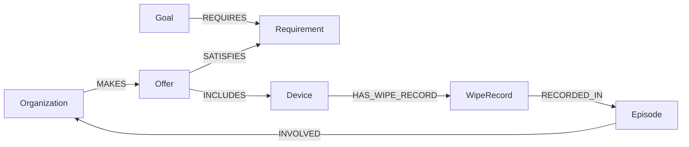

# FalkorDB queries that drive PACT

The executed, parameterized queries are in [`pact.py`](pact.py). These are the central graph operations; the Python planner cannot reconstruct the case without their results. The fixture is synthetic.

## Model



`Revision` and `Proposal` are separate nodes. A proposal stores the checked revision value in a property; there is no edge between them. Every arrow in the diagram is a stored relationship.

## Candidate discovery

```cypher
MATCH (goal:Goal {id:$goal})-[:REQUIRES]->(r:Requirement)
      <-[:SATISFIES]-(offer:Offer)<-[:MAKES]-(org:Organization)
WHERE coalesce(offer.active,true) = true
RETURN r.id, r.quantity, org.id, org.name, offer.id, offer.quantity
ORDER BY r.id, org.id
```

All active offers are retained, including both backups after withdrawal. A separate `Device → WipeRecord` count reduces only the unfinished wiping quantity; `planner.py` checks every bounded partner combination and returns the selected and rejected graph paths.

## Current case, not historical guesswork

```cypher
MATCH (:Goal {id:$id})-[:REQUIRES]->(r:Requirement)
      <-[:SATISFIES]-(o:Offer)<-[:MAKES]-(org:Organization)
WHERE coalesce(o.active,true) = true
RETURN r.id, o.id, o.quantity, o.window_start, o.window_end,
       o.rate_per_hour, o.parallelism, o.minutes_each,
       o.van_capacity, o.trip_minutes, org.id, org.name
```

The schedule uses these quantities and windows. A separate path from the donor offer to device records checks actual fixture inventory. Historical failures do not override current offer terms.

## Old episode relevance

```cypher
MATCH (e:Episode {kind:'failed_capacity'})-[:INVOLVED]->
      (org:Organization)-[:MAKES]->(offer:Offer)
RETURN e.id, org.name, e.rate_at_event, e.required_rate,
       offer.id, offer.rate_per_hour
```

The old W2 rate of five per hour is marked obsolete when the live offer states ten per hour. This rule is a bounded comparison, not a general learned memory model.

## Atomic simulated withdrawal

`simulate_withdrawal()` performs one graph write query. It first requires all ten named device nodes, then deactivates W, activates W2 and W3, advances the case revision, and creates the episode and ten wipe records. If the node precondition fails, the query produces no mutation; `verify.py` checks that failure, replay, and concurrent reads.

## Revision-bound pending proposal

```cypher
MATCH (r:Revision {id:'case'})
WHERE r.value=$expected
CREATE (p:Proposal {id:$id, revision:$expected,
  status:'pending_human_review', delivery_minute:$delivery,
  selected_offer_ids:$offers, evidence_ids:$evidence,
  created_at:$created_at, simulated:true})
RETURN p.id
```

The check and creation are one query. If a supported mutation advances the case revision, the stale proposal write returns no row. A pending proposal represents no approval, reservation, contact or delivery.
